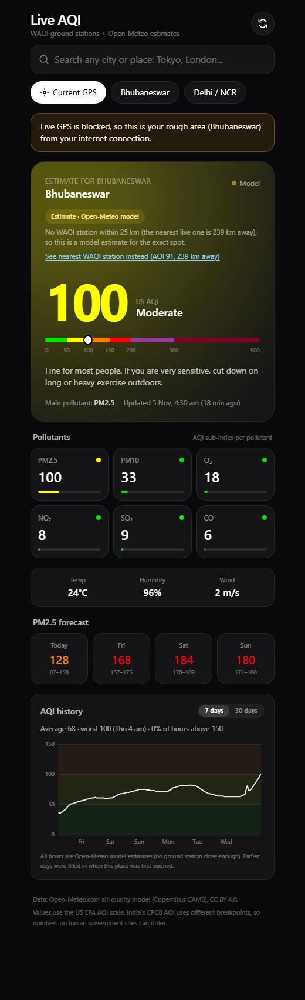

# Live AQI

A small web app that shows the air quality where you are, made mainly for my iPhone. It runs on Cloudflare Workers, with an hourly history stored in Cloudflare D1.

Live: https://samarth-aqi.samarth0205.workers.dev



## Why I built it

I'm in Bhubaneswar, and the closest WAQI ground station is about 240 km away in West Bengal. Most AQI apps show that station's number anyway, which says nothing about the air here. I wanted an app that tells me which source it used and why, and falls back to a model estimate when no station is close.

## What it does

- Shows US AQI, the main pollutant, PM2.5/PM10/O3/NO2/SO2/CO sub-indices, temperature, humidity and wind
- Picks between a measured reading (WAQI ground station) and a model estimate (Open-Meteo, based on Copernicus CAMS) and labels which one you're looking at
- Lets you switch to the other source with one tap, so you can compare
- Has a 4 day PM2.5 forecast
- Draws hourly AQI for the last 7 or 30 days, with tap-to-inspect on the chart
- Searches any city or WAQI station
- Works as a home-screen app on iPhone, including a fix for iOS blocking location in home-screen apps

## How it picks a source

The rule runs on the server (`bestForPoint` in `src/sources.js`):

1. Find the nearest WAQI station. The WAQI geo feed sometimes jumps far away (it once matched Bhubaneswar to Lhasa), so the backend first scans the map in growing boxes, then tries the geo feed, then reverse geocodes the city with Nominatim and searches WAQI by name.
2. If that station is within 25 km and reported in the last 3 hours, use it.
3. Otherwise use the Open-Meteo estimate for the exact point.
4. If Open-Meteo is down, show the far station with a warning instead of nothing.

The page shows the reason in plain words, for example "No WAQI station within 25 km (the nearest live one is 239 km away), so this is a model estimate for the exact spot."

One thing I found while testing: in November 2026, every WAQI station in Mumbai and Bangalore had been offline since June. The rule handles that on its own. Stale stations get skipped and the model is used.

## Architecture

```
iPhone / browser
   │  GET /api/...
   ▼
Cloudflare Worker (src/worker.js)
   ├── sources.js   WAQI, Open-Meteo, Nominatim + the source rule
   ├── history.js   hourly history in D1
   └── public/      the page (one HTML file + prebuilt Tailwind CSS)

Cron, 7 minutes past every hour → history.js records a reading for each tracked place
```

The WAQI token is a Worker secret. The page never sees it, and all API calls go through the Worker. Upstream responses are cached at the Cloudflare edge (station feeds for 10 minutes, model data for 15, searches for a day), which keeps the app fast and well inside WAQI's rate limits.

### API

| Endpoint | Returns |
|---|---|
| `GET /api/aqi?lat=&lon=` | best reading for a point, the reason, and both sources |
| `GET /api/station?uid=` | one WAQI station |
| `GET /api/search?q=` | WAQI station search |
| `GET /api/place?q=` | best live station for a city name |
| `GET /api/history?lat=&lon=&days=7\|30` | hourly AQI points, each marked `waqi` or `model` |
| `GET /api/whereami` | rough city-level location from Cloudflare's IP data |
| `GET /api/health` | liveness check |

Only GET is allowed. Coordinates and text inputs are validated before anything is sent upstream.

### History

- The first time a place is opened, the backend fills in the past 30 days from Open-Meteo's hourly data, so the chart is useful straight away.
- After that, the cron job stores one reading per hour from whichever source the rule picks.
- It tracks the 4 most recently opened places. That keeps the hourly job within the Workers free plan's subrequest limit. Readings older than 35 days are deleted.

The schema is in `schema.sql`: a `places` table and a `readings` table keyed by place and hour.

## Location and privacy

- GPS is rounded to 2 decimal places (about 1 km) on the phone before it is sent anywhere. AQI doesn't change at that scale.
- The history database stores those rounded points and AQI numbers. No accounts and no personal data.
- iOS often refuses location to home-screen web apps even when Safari has permission. To get around that, the app saves your last GPS spot in the link (`#home=lat,lon`) when you add it to the home screen. If live GPS is blocked and your IP location is more than 100 km from the saved spot, it assumes you're travelling and uses the IP city.

## Run it yourself

You need Node 18+ and a free Cloudflare account. Get a WAQI token from https://aqicn.org/data-platform/token/.

```bash
npm install
echo "WAQI_TOKEN=your_token_here" > .dev.vars

# create the history database, then put its id in wrangler.jsonc
npx wrangler d1 create aqi-history
npx wrangler d1 execute aqi-history --local --file schema.sql

npm run dev          # builds the CSS, runs on http://127.0.0.1:8787
```

To deploy:

```bash
npx wrangler login
npx wrangler secret bulk .dev.vars
npx wrangler d1 execute aqi-history --remote --file schema.sql
npm run deploy
```

If you change classes in `public/index.html`, run `npm run css` to rebuild `public/app.css`. The deploy script does this for you.

## Limits

- Numbers use the US EPA AQI scale. India's CPCB scale has different breakpoints, so values on Indian government sites won't match.
- Model estimates can be well off from ground readings. In Delhi I saw the model at 209 while the station measured 344, so treat model numbers as a rough guide.
- I wanted CPCB station data as a third source, but data.gov.in needs Aadhaar verification for an API key, so I left it out.

## Data sources

- [World Air Quality Index Project](https://waqi.info) for ground station readings
- [Open-Meteo](https://open-meteo.com) air quality and weather APIs (Copernicus CAMS data, CC BY 4.0)
- [Nominatim / OpenStreetMap](https://nominatim.openstreetmap.org) for place names

Built by Samarth Srivastava.
